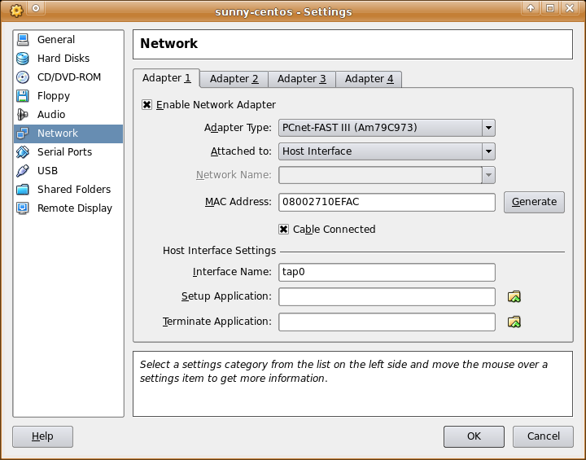

I use [Virtualbox](http://www.virtualbox.org) for all of my virtual machining needs.  For some of my guest vms I like to use "host" networking, meaning that essentially the vm will share the hosts network adapter using a bridge and a TAP interface on the host computer to perform its virtual networking magic.  However, it can be a little more tricky to setup than using Virtualbox's other type of networking, NAT.

However, with two packages "bridge-utils" and "uml-utilities" the chore of setting up a bridge interface on Ubuntu (and maybe even Debian) is almost pain free.<!--more-->

DISCLAIMER: This might not work for your particular setup or distribution.  If it does, you can shout woo-hoo and thanks the good folks at Debian and Ubuntu.  If it doesn't work, then consult this file:

zcat /usr/share/doc/bridge-utils/README.Debian.gz | less

Now, on to the good stuff.

\- First we need to install the necessary packages:

sudo aptitude install bridge-utils uml-utilities

\- Edit your /etc/network/interfaces file to look something like:

auto lo iface lo inet loopback

auto tap0 iface tap0 inet manual

auto br0 iface br0 inet dhcp up ifconfig $IFACE 0.0.0.0 up down ifconfig $IFACE down tunctl\_user dheebner bridge\_ports eth0 tap0

auto eth0 iface eth0 inet manual

\- Reboot

\- When the system is back up, drop to the terminal and issue an "ifconfig /all" and see if your bridge (br0) and tap interface (tap0) are listed.

\- Fire up Virtualbox, set your network interface to "Attached to: Host" and fill in "Interface Name: tap0" (unless you named your tap interface something else.

Virtualbox Network Configuration

\- If you are going to use Vurtualbox as a non-root user (recommended) then you will need to give the proper permssions to the device file "/dev/net/tun" and/or add your name to the proper groups:

sudo usermod -a -G vboxusers username

sudo usermod -a -G uml-net username

\- Fire up your virtual machine and see if you can reach the network.

Yay!
