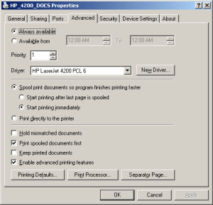
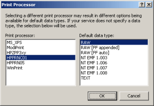

Here is one that took a bit o' detective work to solve.  A client of mine was lamenting how they couldn't print multiple copies to their HP4200 printers, unless the document was longer than one page.  If the document was one page, you could set the number of copies to one bazillion and it would still only print one copy.

A Google search turned up a boatload of hits, but no fix.  The solutions ranged from unchecking/checking "collate", [disabling "mopier/job storage" options](http://h20000.www2.hp.com/bizsupport/TechSupport/Document.jsp?lang=en&cc=us&taskId=110&prodSeriesId=84028&prodTypeId=18972&prodSeriesId=84028&objectID=bpl13068), etc., etc.  Tried them all to no avail.

But then the answer came down from high, so I'll spare you the boring details of how I arrived at the solution.  Actually it was part luck, and part deductive reasoning (well, OK, mostly luck).  The answer simply boiled down to the Print Processor setting.<!--more-->Here is the solution that worked for me.  Your mileage may vary like a Hummer in need of a tune-up so take all of this with the proverbial grain of salt.

Printer model: HP LaserJet 4200 using PCL6 driver on Windows Server 2003 SBS

1. Access the printer driver properties in whatever way works best for you (Printers and Faxes -> right-click on the printer -> Properties blah, blah, blah)
2. Click on the **Advanced** tab 
3. Click on the **Print Processor** button, and then choose one of the HP entries on the left-hand side: 
4. What I had found was that the HP printers that only printed one copy were set to use "WinPrint" as the print processor.  So switching it to the HPPRNC01 did the trick.
5. Back your way out and Viola!  See if you can print multiple copies!

Happy printing!
