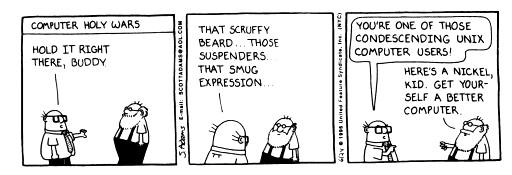

# Almost There

Virtualization has been near and ear to my heart ever since I started using VMware workstation in the late '90s.  I'm sure the ol' mainframe guys are thinking "pffft, boy, I've been virtualizing my \*nix and VMS/VAX instances while you were plinking away on your Apple IIe in middle school."  Which is one reason I keep this Dilbert comic on my board at work: 

 

 

 

 

<!--more-->To me, virtualization is a huge component of infrastructure optimization.  Every time I unbox a new server, PC, or electronic gadget I am equally excited and also racked with guilt knowing that the IT industry is not all that great for the [environment and third-world economics](http://sitemaker.umich.edu/section002group3/introduction__two_paradigms).  But virtualization can help in this regard by reducing the number of physical servers we have to use, therefore less styrofoam packaging, less electricity being used, and less servers getting decommissioned and getting shipped to some [developing nation or non-industrialized country](http://en.wikipedia.org/wiki/Electronic_waste).  But that's a post for another time.

Back to virtualization.  So my experience with it goes back about 15 years at the time of this writing, but only in the last several years have things really start to heat up and get _really_ interesting.  For most of those 15 years that I've been using virtualization, VMware has the been the major force and de facto standard in virtualization, which has also meant that the barriers to virtualization for smaller shops have been high in terms of cost.  But in the last few years we've started to see the [hypervisor](http://en.wikipedia.org/wiki/Hypervisor) become more and more commoditized and easier to use.  VMware and Microsoft have "sort of" free hypervisors, Citrix has open-sourced XenServer, and of course there is open-source Linux KVM and the open-source Xen.  For running virtual machines (VMs) on your desktop computer there are also fantastic options such as Oracle's (nee Sun, nee innotek GmbH) VirtualBox, Microsoft's Virtual PC (now part of certain versions of Windows as "XP Mode"), and of course there is still the venerable VMware Workstation (and a long list of others).  So what is the point of this history I am laying down in this post?  Well, I'm sure Wikipedia has a much better version of the history of virtualization, but my whole point is that the market is changing drastically and has been for a few years.  But in this post I want to mostly focus on my decisions of **_which_** virtualization platform to go with at the current time.  So without further ado...

## My Personal Environment

I currently have a hodge-podge of several old physical machines that I use as servers (mail, web, Win2K8 AD, and others for internal services such as Logitech Media Server).  I've been wanting to virtualize all of this for years now but every time I tried, I just ended up frustrated since I didn't want to fork out the money for a beefy server with multiple spindles and a spiffy RAID card.  Besides, RAID is nice as hard drives are usually the component that fails the most, but having one server to rule them all just scares me as I would have one point of failure for ALL of the VMs sitting on that one server.

But then I got a better paying job and someone donated a nice 42U APC rack to me and this got me motivated to get everything organized and virtualized.  So, I stuffed the rack into my Subaru, took it home, and converted one of our 2nd floor rooms to my data center.  \[my wife was overjoyed :-) - "is the floor going to support this thing?"\]  So I put together a few extra pennies and splurged for two Lenovo ThinkCentre machines.  While not true servers, they pretty much had the same specs (Xeon CPUs, ECC RAM, etc.) and were a heck of a lot cheaper than 1U or 2U servers.  I was able to get two of these boxes for the price of one rack-mount.  Granted, I don't have KVMoIP or front-facing RAID cages to quickly swap out drives, but let's remember, I'm not running a mission-critical data center here.  I then capped it off with a Synology DS1512+ and filled that up with 5 WD RE4 WD5003ABYX 500GB drives.  Now to pick the software.

I started off where I was most familiar, VMware.  A few years ago they had the "free" ESXi 4 server (sans some nice backup and HA features) so I wanted to see if anything was different.  I gave up pretty quickly trying to wade through the requirements and the new licensing.  Blech. Too confusing.  So I went back to another great standby, Proxmox PVE which is a fantastic product and free and can use Linux KVM!  So I loaded PVE on both servers and quickly had a mostly HA setup with two PVE "hypervisors" and iSCSI shared storage via the DS1512+ so that I could move VMs back and forth and take advantage of the HA features.  I setup some test VMs, migrated them back and forth between the two hosts and things were looking up. But then reading through the docs on HA, I came across this [post on their wiki](http://pve.proxmox.com/wiki/Two-Node_High_Availability_Cluster).  Uh-oh.  If I had all day to play around with this stuff, I'd probably dig in and get it setup, but even then it seemed like it would be a hack.  Side note: that's what I don't like about Microsoft products.  They are (mostly) easy to setup and get running, but when things start going downhill then it often takes mountains of time to research and figure out the obscure registry setting that might fix the issue.  So I started having Microsoft flashbacks.  No thanks.  The other thing that concerns me about PVE is that all of the services run on each server - HTTP, database, etc. which starts to veer away from the whole point of the thin hypervisor.  The search was back on.

I looked at the up-and-coming frameworks out there (OpenStack, CloudStack, Eucalyptus, etc.) but these required _at least_ three servers and a large investment in time, neither of which I had at the time.  So I figured I'd take a look at Xen and Citrix XenServer.  That was right around the time that Citrix decided to open-source XenServer with all of its features - not some crippled version like VMware.  From the docs it looked like I could setup a two-node HA cluster with the only downside being the XenCenter software was only available for Windows.  Oh well, I'll just use my Win7 VM that I have on my laptop and fire that up every time I need to manage the XenServer.  So I dove in and got everything up and running pretty quickly.  Everything was working great.  I had a Win2K8 VM up and running and made it my FSMO so that I could demote my physical Win2K8 box (which was running an Atom CPU - slow, but it works).  I then created a Debian Wheezy VM to control my Ubiquiti Unifi WAPs.  I tested the migration back and forth from one host to another, tested the ability for the guests to automatically restart if one of the hosts went down, and even tested moving the guests' disks from one storage resource to another.  It all worked 100%.  I was in virtualization nirvana!

## But then things started to come crashing down

One of the reasons I wanted to get things virtualized was my Zimbra mail server.  I have been using Zimbra OSE since 5.x and my physical server was getting long in the tooth.  The drives in my software raid setup were starting to throw SMART errors, so reboots were getting scary.  Also my version of Ubuntu 8.04 was deprecated for any version of Zimbra higher than 7.2.5, so I also couldn't upgrade Zimbra anymore.  It was time to move it.  So to get to Zimbra 8.x, I needed to use one of their supported Linux platforms which was either CentOS 6.4 or Ubuntu 12.04LTS.  Not a problem - now I've got my XenServer HA pool fired up and ready to go!

So I setup a VM running CentOS 6.4 and was about to start the migration of Zimbra.  But then I noticed weird kernel issues on boot (didn't write them down), and then the networking in the guest VM started acting flaky.  SSH would take forever to authenticate. Pings to other resources resulted in DUP messages on every other ICMP packet.  It probably had something to do with the LACP bonding or something goofy with my old D-link switch (one of these days I'll upgrade all of my gear to Procurve).  So I setup an Ubuntu 12.04LTS guest.  That was even worse!  Installation went smoothly, but then the guest wouldn't even get past the boot phase.  It would hang up trying to mount the swap partition.  Probably a kernel incompatibility issue I told myself, but when I hit two brick walls with any product I tend to throw in the towel.  Fool me once and all of that good stuff.  Besides, the more I read about XenServer, the more I realized it wasn't fully baked yet.  It was running [older software](http://xenserver.org/overview-xenserver-open-source-virtualization/project-roadmap.html) it would seem and possibly that was causing the network and kernel issues I was seeing.  I started to wonder if Citrix tuned XenServer to prefer Windows guests.

## Lesson Learned

So in the end, I decided to roll my own virtualization platform using KVM on Debian Wheezy hosts and Virt-manager on my Fedora 19 laptop.  So far so good.  I haven't run into any major issues yet, and I feel safer knowing there is no custom trickery going on to obfuscate the complexity of running a virtualization platform.  Lesson learned?  The commercial vendors have done a good job of "dumbing down" virtualization with point-and-click interfaces, but in the end when things go wrong it seems like it is pretty easy to get caught with your pants down.  Unless of course you're willing to shell out a lot of cash to pay for the full versions and support contracts.

I'll keep my eye on Citrix / XenServer as I think it's a pretty compelling product.  If they can update the kernel and some other features (and make a Linux-friendly management console), all the while still keeping it "thin" then I think they will have a hit on their hands.  But for now I'll stick with rollin' my own.
